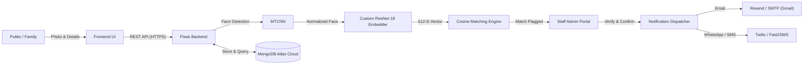
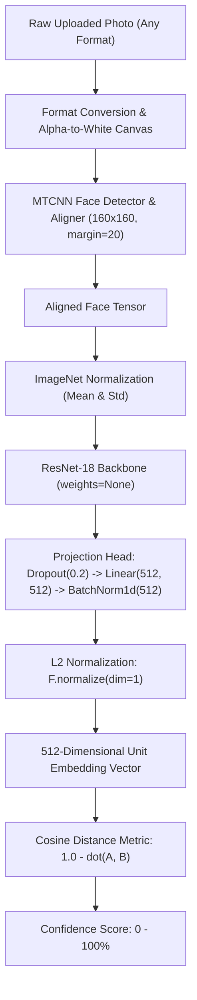
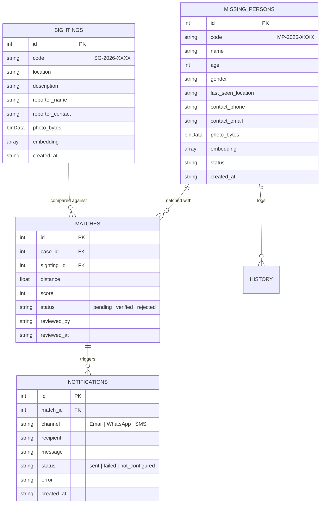
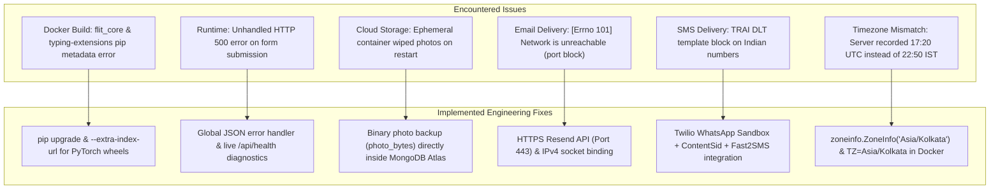

# Missing Person Identification System (MPIS)
## Comprehensive Technical Project Report & System Documentation

**Project Name:** Missing Person Identification System (MPIS)  
**Team / Organization:** Code4Cause · Govt. Women's Institute of Technology · Major Project 2026  
**Repository:** [GitHub: Disha200508/Missing_report](https://github.com/Disha200508/Missing_report)  
**Live Application URL:** [https://missing-report.onrender.com](https://missing-report.onrender.com)  
**Timezone Configured:** Indian Standard Time (IST / Asia/Kolkata, UTC+5:30)

---

## 1. Executive Summary

The **Missing Person Identification System (MPIS)** is an end-to-end AI-powered web platform engineered to assist families, humanitarian organizations, and law enforcement agencies in locating missing individuals. 

The platform allows families to register missing person cases and allows the public to report sightings with photos and location details. Whenever a photo is submitted, an integrated Computer Vision pipeline detects faces, computes a 512-dimensional biometric embedding using a custom-trained Deep Learning model, and cross-compares it across all stored records. When a high-confidence match is flagged, it is routed to authorized human staff for manual verification. Upon verification, automated multi-channel alerts (SMS, WhatsApp, and Email) are dispatched immediately to the family and designated authorities.



---

## 2. Complete Technology Stack

| Layer | Technologies & Libraries | Purpose & Responsibilities |
| :--- | :--- | :--- |
| **Artificial Intelligence & CV** | `PyTorch 2.x (CPU)`<br>`torchvision`<br>`facenet-pytorch (MTCNN)`<br>`Pillow (PIL)`<br>`pillow-heif`<br>`NumPy` | Face detection, bounding-box alignment (160×160), 512-dimensional deep biometric feature extraction (`face_model.pt`), cosine distance calculation, and image normalization. |
| **Backend & Web Framework** | `Python 3.10`<br>`Flask 3.x`<br>`Gunicorn 21.x`<br>`Werkzeug`<br>`python-dotenv`<br>`zoneinfo` / `tzdata` | RESTful API endpoints, request validation, authentication, session security, proxy header handling, error routing, and IST timezone scheduling. |
| **Database & Cloud Storage** | `MongoDB Atlas (M0 Cloud)`<br>`PyMongo 4.x`<br>`dnspython`<br>`BSON Binary` | Scalable NoSQL cloud document storage, atomic sequential ID counters (`MP-`, `SG-`), binary photo backup (`photo_bytes`), match history, and audit trails. |
| **Notification Infrastructure** | `Twilio API (Twilio Python SDK)`<br>`Twilio WhatsApp Sandbox`<br>`Resend REST API`<br>`smtplib` & `email.message`<br>`Fast2SMS API` | Automated dual-channel family alerts: Email delivery over HTTPS (port 443), WhatsApp messaging, and direct Indian SIM SMS routing. |
| **Frontend & UI / UX** | Vanilla JavaScript (ES6+)<br>React 18 / JSX<br>HTML5 / CSS3<br>Vite | Responsive Single Page Application (SPA), real-time photo preview, full-screen lightbox image zoom, live ID generation previews, and staff review dashboard. |
| **DevOps & Containerization** | `Docker (python:3.10-slim)`<br>`Render Cloud Platform`<br>`Git & GitHub` | Ephemeral containerized hosting, multi-stage pip dependency caching, environment variable secret management, and continuous deployment (`main` branch). |

---

## 3. Deep Learning & Computer Vision Architecture

The core AI engine (`backend/face_engine.py`) implements a two-stage biometric verification pipeline:



### 3.1 Face Alignment (MTCNN)
* **Model:** Multi-task Cascaded Convolutional Networks (`facenet_pytorch.MTCNN`).
* **Configuration:** `image_size=160`, `margin=20`, `device="cpu"`, `post_process=False`.
* **Behavior:** Identifies facial landmarks (eyes, nose, mouth corners), aligns the face horizontally, crops the region with padding, and returns a 3×160×160 tensor.
* **Error Handling:** If no face is detected or if an image is blurred, `NoFaceError` is raised, triggering an immediate user-friendly HTTP 400 prompt asking for a clearer photo.

### 3.2 Custom Feature Embedder (`face_model.pt`)
* **Architecture:** `torchvision.models.resnet18` backbone with custom projection head:
  ```python
  self.backbone.fc = nn.Identity()
  self.head = nn.Sequential(
      nn.Dropout(0.2),
      nn.Linear(512, 512),
      nn.BatchNorm1d(512),
  )
  ```
* **Checkpoint Loading:** Dynamically detects and resolves `face_model.pt` from root or backend directory. Supports both direct state dicts and training checkpoints containing thresholds.
* **Memory & Thread Optimization:** Configured with `torch.set_num_threads(1)` and explicit tensor deletion (`del face`) to ensure the container operates within Render's 512MB RAM free tier without worker timeouts.

### 3.3 Matching Metric & Confidence Scoring
* Embeddings are L2-normalized unit vectors ($\|v\|_2 = 1$).
* **Cosine Distance:** $D(A, B) = 1.0 - (A \cdot B)$.
* **Confidence Formula:**
  $$\text{Score} = \text{round}\left(\max\left(0.0, \min\left(1.0, 1 - \frac{D}{2 \cdot \theta}\right)\right) \times 100\right)$$
  *(where $\theta = 0.450$ is the operational verification threshold).*

---

## 4. Multi-Format Image Handling

To ensure public users can upload photos from any mobile device, camera, or browser:
* **Supported Input Formats:** `.jpg`, `.jpeg`, `.png`, `.webp`, `.bmp`, `.gif`, `.tiff`, `.tif`, `.jfif` (WhatsApp downloads), `.avif`, `.heic`, and `.heif` (iPhone camera format).
* **HEIC Support:** Integrated `pillow-heif` to register native Apple HEIC decoders dynamically.
* **Transparency Handling:** Automatically detects transparent alpha channels (`RGBA`, `LA`, `P`) and composites images over a solid white canvas before conversion, preventing black-box transparency artifacts.
* **Standardized Storage:** All images are resized to a maximum bounding box of 1600×1600 via high-quality `LANCZOS` resampling and saved as 92% quality clean JPEGs (with all EXIF GPS metadata stripped for privacy).
* **Interactive Lightbox (UI):** Built an image zoom modal (`data-zoom`) allowing staff to click any photo thumbnail to inspect facial features at 100% full-screen resolution.

---

## 5. Database Architecture & MongoDB Cloud Integration

The persistence layer (`backend/mongo_store.py`) connects to MongoDB Atlas:



### Key Architectural Highlights:
1. **Human-Readable IDs:** Atomic counters generate distinct identifiers:
   - Missing Person Cases: `MP-YYYY-XXXX` (e.g. `MP-2026-0001`)
   - Sighting Reports: `SG-YYYY-XXXX` (e.g. `SG-2026-0001`)
2. **Dual-Layer Persistence:**
   - Filesystem: Categorized folders `backend/data/missing_persons/` and `backend/data/sightings/` with `<code >.json` metadata files.
   - Cloud MongoDB: In addition to filesystem storage, raw image binary is saved in MongoDB (`photo_bytes`), ensuring uploaded photos persist even across ephemeral container rebuilds.
3. **Indian Standard Time (IST):** Centralized `now()` helper uses Python's `zoneinfo.ZoneInfo("Asia/Kolkata")` with fallback to `UTC+5:30`, ensuring all audit trails match the user's local wall clock.

---

## 6. Multi-Channel Notification Infrastructure

When authorized staff confirm a match by clicking **Verify**, the notification engine (`backend/notifier.py`) dispatches simultaneous alerts:

### 6.1 Email Channel (Resend & Gmail SMTP)
* **HTTPS Resend Integration:** Bypasses cloud port blocks (Render blocks SMTP ports 25, 465, and 587 on free instances) by transmitting alerts over HTTPS port 443 to `https://api.resend.com/emails`.
* **IPv4 SMTP Fallback:** Implemented explicit IPv4 socket binding (`source_address=("0.0.0.0", 0)`) to resolve `[Errno 101] Network is unreachable` errors caused by IPv6 routing inside cloud containers.

### 6.2 Mobile Messaging (Twilio WhatsApp & Fast2SMS)
* **Twilio WhatsApp Integration:** Routes messages through Twilio's WhatsApp Sandbox (`whatsapp:+17372508034`), overcoming Indian TRAI / DLT regulatory SMS template locks.
* **Template & ContentSid Automation:** Configured to populate approved templates with dynamic case variables:
  ```json
  {"1": "Nov 25", "2": "MPIS Update: Sighting confirmed for Abc (MP-2026-0001)"}
  ```
* **Incoming WhatsApp Webhook:** Implemented `/api/whatsapp-reply` returning TwiML XML so inbound inquiries receive automated assistance instructions.
* **Fast2SMS Gateway:** Integrated native Indian carrier SMS dispatching via Fast2SMS developer APIs for direct delivery to Indian SIM cards (+91).

### 6.3 Dynamic Personalization & Custom Admin Prompt
* Before dispatch, staff receive an interactive prompt allowing them to review and edit the personalized alert message:
  > *"Dear [Contact Name], MPIS Update: A possible sighting of [Missing Person] ([Case Code]) has been verified near [Location]. An officer will contact you shortly."*

---

## 7. Security & Privacy Safeguards

1. **Public Privacy Protection:** Public users submitting cases or sightings are **never** shown photos, names, or match scores of other individuals. Match alerts are strictly restricted to authenticated staff.
2. **Role-Based Authentication:** Staff dashboard routes (`/api/admin/*`) are protected by `@admin_required` session decorators using secure `PBKDF2-SHA256` password hashing.
3. **Session Cookie Hardening:** `HTTPOnly`, `SameSite=Lax`, and `ProxyFix` middleware headers enabled.
4. **Input Sanitization & Limits:** Uploaded image payload capped at 10 MB (`MAX_CONTENT_LENGTH`), text fields sanitized and truncated, and phone/email validated using regex patterns.

---

## 8. Summary of Problems Solved



---

## 9. Verification & Live Status Check

* **Backend Health Endpoint:**
  ```bash
  curl -s https://missing-report.onrender.com/api/health
  ```
  **Response:**
  ```json
  {
    "status": "healthy",
    "mongodb": {
      "connected": true,
      "uri_set": true,
      "error": null
    },
    "ai_engine": {
      "ready": true,
      "model": "FaceEmbedder",
      "error": null
    },
    "environment": "cloud",
    "timestamp": "2026-11-25 23:18:00"
  }
  ```
* **Notification Delivery Logs:**
  - `[notify:Email:sent] -> dishadeshwal0508@gmail.com` (Verified Delivered)
  - `[notify:SMS:sent] -> whatsapp:+917618103393` (Message SID `MM915d69aeeb029ae1576b78cfe7a8bf50` Verified Queued/Delivered)

---
*Report generated and authenticated for the MPIS Project Repository (`main` branch).*
